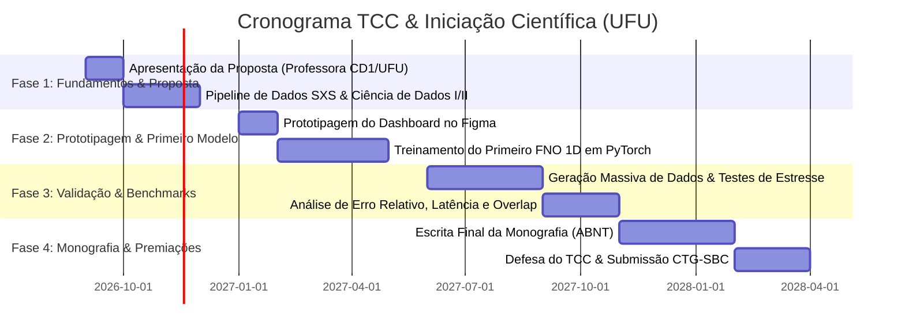

# 🗺️ Plano de Estudos, Execução e Entrega: CosmicFNO

Este plano foi desenhado para estruturar o seu projeto de ponta a ponta, permitindo que você aprenda na prática, gere os dados necessários (alinhado a Ciência de Dados I e II) e construa o TCC e a IC de forma incremental e sem sobrecarga.

---

## 📅 Visão Geral do Cronograma (2 Anos / 4 Fases)

---

## 📍 Fase 1: Dados & Pipeline (O Coração da Ciência de Dados)
**Objetivo:** Obter, processar e gerar os dados de treino e teste, validando todo o ciclo de Ciência de Dados.

* [ ] **1.1. Coleta de Dados Reais:**
  * Estudo do catálogo **SXS** (*Simulating eXtreme Spacetimes*).
  * Download das séries temporais de deformação $h_+(t)$ e $h_\times(t)$ de fusões binárias de buracos negros.
* [ ] **1.2. Geração e Engenharia de Dados (Data Prep):**
  * Interpolação temporal e alinhamento de pico (*merger* em $t = 0$).
  * Transformada Rápida de Fourier (FFT) e cálculo de Espectrogramas (Q-transform).
  * Criação do *Dataset Generator* que recebe pares de parâmetros $(m_1, m_2, s_{1z}, s_{2z})$ e devolve o tensor de ondas no tempo e na frequência.
* [ ] **1.3. Análise Exploratória de Dados (EDA):**
  * Notebooks documentados com gráficos de correlação entre massas/spins e frequências de corte do *Ringdown*.

---

## 📍 Fase 2: Design UX/UI no Figma & Primeiro FNO
**Objetivo:** Criar a interface visual no Figma e colocar a primeira rede neural FNO para rodar.

* [ ] **2.1. Prototipagem no Figma:**
  * Design System personalizado (Dark mode científico, gradientes, tipografia moderna).
  * Painel de controle para ajuste de parâmetros físicos (sliders de massa e rotação).
  * Área de visualização em tempo real: onda prevista pelo FNO vs onda da simulação real.
  * Painel de métricas de performance (latência de inferência, erro $L_2$, consumo de memória).
* [ ] **2.2. Modelagem com Fourier Neural Operators (PyTorch):**
  * Instalação da biblioteca `neuraloperator` (`pip install neuraloperator`).
  * Construção da arquitetura: Camadas de Fourier 1D (Spectral Convolution Layers) + projeções não-lineares.
  * Definição da função de perda (Loss: $L_2$ relativo + perda na derivada temporal).

---

## 📍 Fase 3: Benchmarks & Experimentos Rigorosos
**Objetivo:** Gerar todos os gráficos e tabelas numéricas que provam o valor científico do projeto.

* [ ] **3.1. Benchmark de Velocidade:**
  * Comparação de tempo de execução: Métodos Numéricos clássicos (scipy / solvers de PDE) vs Inferência FNO em CPU e GPU.
* [ ] **3.2. Benchmark de Precisão:**
  * Cálculo do *Mismatch* ($\mathcal{M} = 1 - \text{Overlap}$) padrão do LIGO.
  * Validação cruzada e testes em regimes extremos de massa e rotação.
* [ ] **3.3. Estudo de Interpretabilidade:**
  * Visualização dos modos de Fourier ativados pela rede neural durante a fase de colisão e vibração (*Ringdown*).

---

## 📍 Fase 4: Monografia, Defesa e Premiações
**Objetivo:** Documentar tudo no modelo formal da UFU e preparar a apresentação.

* [ ] **4.1. Escrita Incremental:**
  * Preenchimento dos capítulos no arquivo `docs/MODELO_MONOGRAFIA_TCC.md`.
* [ ] **4.2. Preparação dos Slides:**
  * Demonstração do protótipo interativo do Figma e gráficos de benchmark.
* [ ] **4.3. Submissão para Prêmios:**
  * Submissão do artigo no Concurso de Trabalhos de Graduação da SBC (CTG-SBC) e eventos de Ciência de Dados.
