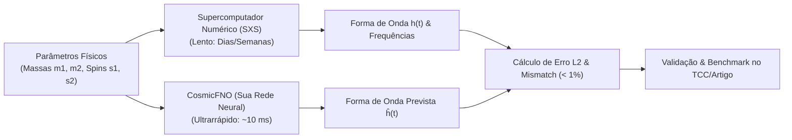

# 🪐 CosmicFNO: Emulação Ultrarrápida de Ondas Gravitacionais com Fourier Neural Operators (FNO)

## 📌 Resumo Executivo da Proposta
* **Autora:** Shayene Figueredo
* **Curso:** Bacharelado em Sistemas de Informação — Universidade Federal de Uberlândia (UFU)
* **Tema:** *AI for Science*, *Deep Learning Científico*, *Fourier Neural Operators (FNO)*, *Processamento de Sinais do Espaço-Tempo* e *Ciência de Dados*.
* **Inspiração Teórica:** O princípio de Nikola Tesla: *"Se você quiser descobrir os segredos do universo, pense em termos de energia, frequência e vibração."*

---

## 🎯 O Problema Científico & Computacional
A colisão de dois buracos negros no cosmos produz deformações no espaço-tempo chamadas **Ondas Gravitacionais**. 
Para prever essas ondas com alta precisão, a física utiliza a **Relatividade Numérica** (resolução computacional direta das equações de campo de Einstein). 

### O Gargalo:
* Simular uma única fusão de buracos negros com rotação (*spin*) e massas diferentes exige **dias ou semanas em supercomputadores (clusters HPC)**.
* Quando observatórios como o **LIGO/Virgo** detectam um sinal no céu, os astrônomos precisam comparar o sinal real com milhares de formas de onda teóricas em tempo real para identificar os parâmetros físicos dos buracos negros. Métodos numéricos tradicionais são lentos demais para esse ritmo.

---

## 💡 A Solução Proposta: *CosmicFNO*
Desenvolver um modelo de emulação (*Surrogate Model*) baseado em **Fourier Neural Operators (FNO)** em PyTorch capaz de prever e simular as formas de onda gravitacional e o espectro de frequências do *Ringdown* (a vibração residual do buraco negro) em **milissegundos** (aceleração de até $10.000\times$), mantendo um erro relativo inferior a 1% em relação à Relatividade Numérica clássica.

---

## 🔬 Pilares de Ciência de Dados & Sistemas de Informação
O projeto atende rigorosamente a todos os critérios de um TCC/IC de excelência em Ciência de Dados:

1. **Engenharia e Geração de Dados (Data Pipeline):**
   * Coleta de dados abertos do catálogo **SXS (*Simulating eXtreme Spacetimes*)**.
   * Geração sintética de parâmetros físicos (Amostragem por Hipercubo Latino / Grid Search) para varredura do espaço de fases.
   * Tratamento de séries temporais: alinhamento de fase, remoção de ruído, decomposição em modos de onda e normalização espectral.
2. **Modelagem & Deep Learning (Fourier Neural Operators):**
   * Operação direta no espaço de frequências usando a Transformada Rápida de Fourier (FFT) em PyTorch.
   * Invariância de resolução (o modelo aprende o operador contínuo e pode prever o sinal em qualquer taxa de amostragem).
3. **Métricas de Ciência de Dados:**
   * Erro Relativo $L_2$, *Overlap/Mismatch* de ondas gravitacionais, tempo de inferência (FLOPs e latência em GPU/CPU), curvas de aprendizado e generalização fora da distribuição.
4. **Produto de Software & UX (Figma -> Dashboard):**
   * Prototipagem completa no **Figma** de um dashboard científico interativo para engenheiros e astrofísicos compararem simulações, variações de frequência e métricas de erro.

---

## 🚀 Por que este projeto é Premiável e Blindado na Banca?
1. **Risco Zero de "Resultado Nulo":** É um problema de aprendizado supervisionado/emulação. O sucesso é medido objetivamente por velocidade e acurácia.
2. **Estado da Arte Mundial (2024-2027):** *Neural Operators* representam a fronteira mais nobre do Machine Learning aplicado à física (*AI for Science*).
3. **Alinhamento com Nikola Tesla:** O algoritmo opera essencialmente na decomposição harmônica de frequência e ressonância.
