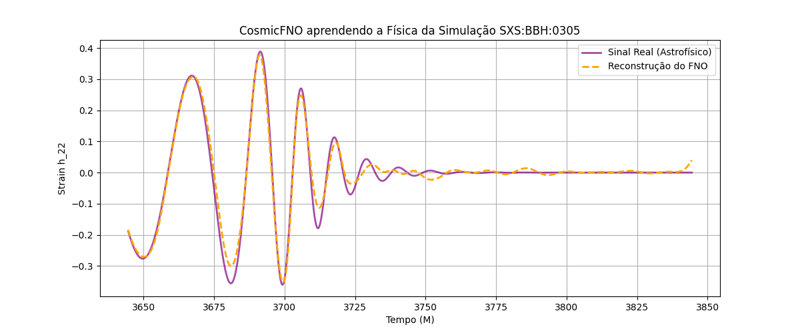
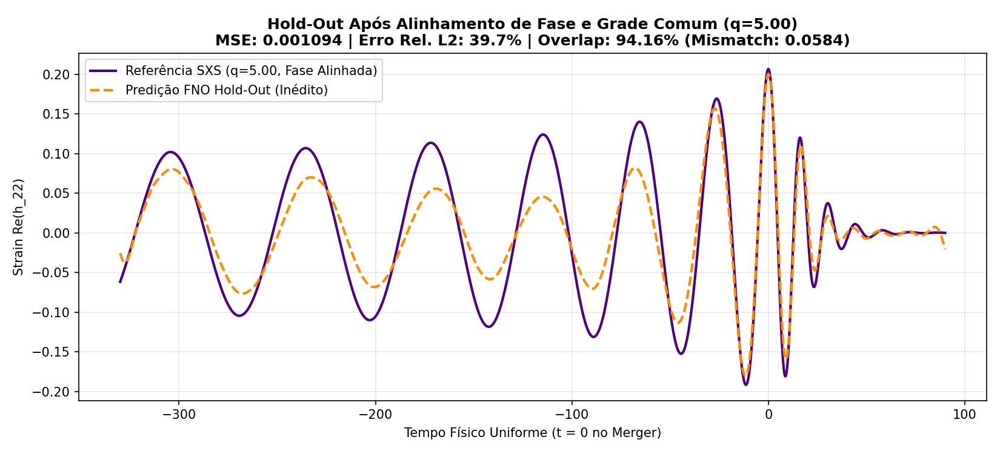

# CosmicFNO: Investigação de Fourier Neural Operators na Emulação de Formas de Onda Gravitacionais

**CosmicFNO** é um projeto de pesquisa em *Scientific Machine Learning* (SciML) que investiga a aplicabilidade de **Fourier Neural Operators (FNOs)** na emulação de formas de onda gravitacionais (*waveforms*) geradas pela coalescência de sistemas binários de buracos negros (BBH), utilizando simulações de Relatividade Numérica do catálogo **SXS** (*Simulating eXtreme Spacetimes*), com foco no modo quadrupolar dominante $h_{22}$.

---

## 1. Problema de Pesquisa e Hipótese Científica

A análise de sinais gravitacionais requer modelos teóricos de formas de onda para identificação e inferência de parâmetros astrofísicos. Simulações de Relatividade Numérica resolvem as equações de campo de Einstein com alta precisão, mas possuem alto custo computacional.

- **Desafio:** Investigar como diferentes arquiteturas neurais capturam dependências temporais globais e variações morfológicas nas fases de *inspiral*, *merger* e *ringdown*.
- **Hipótese:** A parametrização espectral dos *Fourier Neural Operators* (via FFT/IFFT) permite representar interações globais no domínio do tempo/frequência de forma eficiente, oferecendo vantagens na emulação de famílias parametrizadas de formas de onda quando combinada ao alinhamento físico de tempo e fase orbital.

---

## 2. Experimentos Preliminares e Resultados

Todos os experimentos são avaliados utilizando métricas padrão da literatura de Operadores Neurais e Relatividade Numérica (`src/08_metricas_fisicas.py`):
- **MSE** (*Mean Squared Error*)
- **Erro Relativo $L_2$** ($\|h_{\text{ref}} - h_{\text{pred}}\|_2 / \|h_{\text{ref}}\|_2$)
- **Overlap ($\mathcal{O}$)** e **Mismatch ($\mathcal{M} = 1 - \mathcal{O}$)** no espaço de Hilbert $L^2$.

### Experimento 1: Capacidade de Reconstrução (`SXS:BBH:0305`, 100 épocas)
Comparação entre o `CosmicFNO` (32 modos, largura 64) e um modelo baseline `1D-CNN` (4 camadas convolucionais de kernel local) treinados sob condições equivalentes na forma de onda de referência `SXS:BBH:0305` ($q=1.22$):

| Arquitetura | MSE | Erro Relativo $L_2$ | Overlap ($\mathcal{O}$) | Mismatch ($\mathcal{M}$) |
| :--- | :---: | :---: | :---: | :---: |
| **CosmicFNO (32 modos)** | `0.000493` | **17.06%** | **0.991150** | **0.008850** |
| **Baseline 1D-CNN** | `0.015855` | **96.67%** | **0.258804** | **0.741196** |



---

### Experimento 2: Generalização Hold-Out e Alinhamento de Fase Orbital ($\phi_0 = 0$)
Avaliação da capacidade de generalização em simulações **não vistas durante o treinamento** (4 simulações de treino vs 1 simulação de teste em *Hold-Out* cego).

Investigamos o impacto de alinhar não apenas o instante do pico da colisão ($t=0$), mas também a **fase orbital no Merger** ($h_{22}(t) \cdot e^{-i\phi(0)}$ garantindo $\phi(0)=0$) interpolada em uma grade física uniforme $t \in [-330M, +90M]$ (`src/09_alinhamento_fase_e_interpolacao.py`):

| Cenário Avaliado (Hold-Out Cego) | MSE | Erro Relativo $L_2$ | Overlap ($\mathcal{O}$) | Mismatch ($\mathcal{M}$) |
| :--- | :---: | :---: | :---: | :---: |
| **Treinamento (Média de 4 sims)** | `0.000004` | **2.19%** | **0.999693** | **0.000307** |
| **Teste Inédito ($q=5.00$, sem alinhamento de fase)** | `0.009074` | $115.46\%$ | **0.167040** | `0.832960` |
| **Teste Inédito ($q=5.00$, com fase e grade alinhadas)** | **`0.001094`** | **$39.66\%$** | **0.941598** | **`0.058402`** |
| **Teste Inédito ($q=4.00$, com fase e grade alinhadas)** | **`0.000657`** | **$26.73\%$** | **0.990707** | **`0.009293`** |



---

## 3. Estrutura do Repositório e Como Executar

```text
TCC/
├── src/
│   ├── 01b_download_sxs_real.py             # Extração de amostra individual do catálogo SXS
│   ├── 01d_download_alinhado.py             # Extração e alinhamento temporal pelo pico do Merger
│   ├── 02_modelo_fno.py                     # Implementação da arquitetura Fourier Neural Operator 1D
│   ├── 03b_treinamento_real.py              # Experimento 1: Reconstrução em amostra única (FNO)
│   ├── 03d_treinamento_holdout.py           # Experimento 2: Validação Hold-Out entre simulações
│   ├── 04_modelo_cnn_baseline.py            # Experimento 1: Baseline 1D-CNN
│   ├── 06_dashboard_fno.py                  # Plataforma visual interativa em Streamlit
│   ├── 07_animacao_3d.py                    # Visualização 3D da coalescência binária e strain
│   ├── 08_metricas_fisicas.py               # Avaliação por Erro Relativo L2, Overlap e Mismatch
│   └── 09_alinhamento_fase_e_interpolacao.py# Alinhamento de fase orbital (phi_0=0) e grade uniforme
├── docs/                                    # Relatórios técnicos detalhados de cada experimento
└── requirements.txt                         # Dependências do projeto
```

### Instalação e Execução
```bash
pip install -r requirements.txt

# 1. Executar avaliação completa de métricas físicas (L2, Overlap e Mismatch)
python src/08_metricas_fisicas.py

# 2. Executar o experimento de alinhamento de fase orbital e interpolação Hold-Out
python src/09_alinhamento_fase_e_interpolacao.py

# 3. Iniciar o laboratório visual interativo (Streamlit)
streamlit run src/06_dashboard_fno.py
```

---

## 4. Limitações Atuais e Próximos Passos da Pesquisa

1. **Escala do Conjunto de Dados:** Os experimentos preliminares utilizam um subconjunto reduzido de 5 simulações do catálogo SXS. A próxima etapa consiste em ampliar a curadoria para dezenas de simulações cobrindo sistematicamente o espaço de razões de massa ($q$) e spins ($\chi_{1z}, \chi_{2z}$).
2. **Decomposição Amplitude-Fase:** Emular diretamente a parte real oscilatória $\text{Re}(h_{22}(t))$ ainda apresenta sensibilidade à defasagem acumulada em longas janelas de *inspiral*. Investigaremos a modelagem separada da envoltória de amplitude $A(t)$ e da fase acumulada $\phi(t)$.
3. **Comparação Arquitetural Expandida:** Avaliar arquiteturas CNN 1D mais profundas (com convoluções dilatadas) e condicionamento físico explícito sob validação cruzada.
