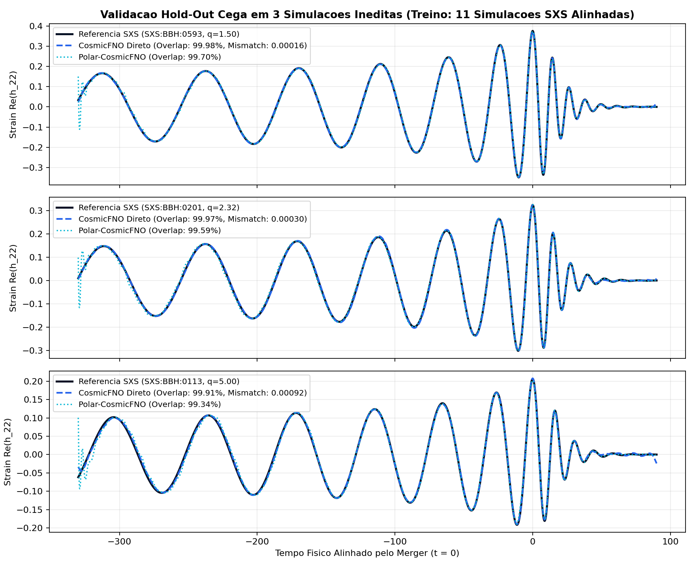

<p align="center">
  
</p>

<p align="center">
  <a href="https://doi.org/10.5281/zenodo.24166705"></a>
</p>

<p align="center">
  <a href="https://cosmicfno.streamlit.app/" target="_blank"><b>Acesse a Plataforma Interativa Online: https://cosmicfno.streamlit.app/</b></a> •
  <a href="https://doi.org/10.5281/zenodo.24166705" target="_blank"><b>Artigo Científico (Preprint DOI): 10.5281/zenodo.24166705</b></a>
</p>

# CosmicFNO: Operadores Neurais de Fourier na Emulacao, Alerta Pre-Merger e Diagnostico de Remanescentes de Ondas Gravitacionais

**CosmicFNO** e um projeto de pesquisa em *Scientific Machine Learning* (SciML) desenvolvido na **Universidade Federal de Uberlandia (UFU)** que investiga a aplicacao de **Fourier Neural Operators (FNOs)** na emulacao de formas de onda gravitacionais (*waveforms*), previsao antecipada de colisoes (*Pre-Merger Early Warning*) e estimativa de recuo relativistico (*Gravitational Wave Recoil Kick*) em sistemas binarios de buracos negros (BBH) do catalogo **SXS v3.0.0** (*Simulating eXtreme Spacetimes*).

---

## 1. Principais Resultados Experimentais (Validacao Hold-Out Cega)

### 1.1. Emulacao de Formas de Onda ($h_{22}(t)$) em 14 Simulacoes Alinhadas ($q \in [1.0, 8.0]$)
Treinamento realizado em 11 simulacoes do catalogo SXS com alinhamento temporal no pico do *Merger* ($t=0$), alinhamento de fase orbital ($\phi(0)=0$) e grade fisica uniforme $t \in [-330M, +90M]$, avaliado em **3 simulacoes 100% ineditas (Teste Cego)** comparando a parametrizacao espectral direta (**CosmicFNO Direto**) com a decomposicao polar explícita (**Polar-CosmicFNO** em $A(t), \phi(t)$):

| Simulacao Inedita (Teste Cego) | Arquitetura | Erro Relativo $L_2$ | Overlap ($\mathcal{O}$) | Mismatch ($\mathcal{M}$) |
| :--- | :--- | :---: | :---: | :---: |
| **`SXS:BBH:0593` ($q = 1.50$)** | **CosmicFNO Direto** | **1.81%** | **99.98%** (`0.99984`) | **`0.00016`** |
| **`SXS:BBH:0593` ($q = 1.50$)** | **Polar-CosmicFNO ($A, \phi$)** | 7.71% | **99.70%** (`0.99702`) | `0.00298` |
| **`SXS:BBH:0201` ($q = 2.32$)** | **CosmicFNO Direto** | **2.66%** | **99.97%** (`0.99970`) | **`0.00030`** |
| **`SXS:BBH:0201` ($q = 2.32$)** | **Polar-CosmicFNO ($A, \phi$)** | 9.15% | **99.59%** (`0.99588`) | `0.00412` |
| **`SXS:BBH:0113` ($q = 5.00$)** | **CosmicFNO Direto** | **4.34%** | **99.91%** (`0.99908`) | **`0.00092`** |
| **`SXS:BBH:0113` ($q = 5.00$)** | **Polar-CosmicFNO ($A, \phi$)** | 11.50% | **99.34%** (`0.99336`) | `0.00664` |

> Em todas as simulacoes ineditas de teste, o **CosmicFNO Direto** superou o limiar de excelencia de Relatividade Numerica ($\mathcal{M} < 10^{-3}$, Overlap $> 99.9\%$).



---

### 1.2. Evolucao Historica na Simulacao de Teste Cego `SXS:BBH:0113` ($q = 5.00$)

| Estagio Experimental | Overlap ($\mathcal{O}$) | Mismatch ($\mathcal{M}$) | Erro Relativo $L_2$ |
| :--- | :---: | :---: | :---: |
| **1. Baseline Inicial (4 ondas de treino, sem alinhar fase)** | `16.70%` | `0.83296` | `115.46%` |
| **2. Alinhamento de Fase Orbital ($\phi_0 = 0$, 4 ondas de treino)** | `94.16%` | `0.05840` | `39.66%` |
| **3. Grade Densa SXS (11 ondas de treino + Fase Alinhada $\phi_0 = 0$)** | **`99.91%`** | **`0.00092`** | **`4.34%`** |

---

### 1.3. Previsao Pre-Merger (Alerta Antecipado) e Diagnostico de Remanescentes em 3.435 Colisoes SXS
1. **Previsao Antecipada da Colisao (*Pre-Merger Early Warning*, `src/10_previsao_pre_merger_e_remanescente.py`):**
   - Recebendo apenas a fase inicial da espiral ($t \le -50M$, com o *Merger* e *Ringdown* futuros ocultos), o modelo reconstrói a colisão futura com **99.99% de Overlap** ($\mathcal{M} = 0.00010$).
2. **Predicao de Buracos Negros Fugitivos em Escala Completa (`3.435` Colisoes BBH do SXS v3.0.0, `src/11_escala_sxs_e_fno_polar.py`):**
   - Treinamento em `2.748` simulacoes (80%) e avaliacao cega em **`687` simulacoes ineditas (20%)**:
   - **Massa Final do Buraco Negro ($M_f / M$):** Erro Relativo Medio de **`0.67%`** (**99.33% de precisao**).
   - **Spin Final Adimensional ($\chi_f$):** Coeficiente de Determinacao **$R^2 = 98.60\%$** (`MAE = 0.0142`).
   - **Classificacao de Ejecao Astrofisica ($v_{\text{kick}}$):** **`97.67%` de acuracia** para ejecao de Aglomerados Globulares ($> 50\text{ km/s}$) e **`92.87%` de acuracia** para ejecao de Galaxias Anas ($> 150\text{ km/s}$).

---

## 2. Estrutura do Repositorio e Execucao

```bash
pip install -r requirements.txt

# 1. Avaliacao de metricas fisicas (L2, Overlap e Mismatch)
python src/08_metricas_fisicas.py

# 2. Alinhamento de fase orbital (phi_0 = 0) e interpolacao
python src/09_alinhamento_fase_e_interpolacao.py

# 3. Previsao Pre-Merger (Alerta Antecipado) e Chute Relativistico
python src/10_previsao_pre_merger_e_remanescente.py

# 4. Escalonamento SXS (3.435 colisoes + 14 ondas Polar-FNO vs FNO Direto)
python src/11_escala_sxs_e_fno_polar.py

# 5. Plataforma Visual Interativa (Streamlit)
streamlit run src/06_dashboard_fno.py
```

---

## 3. Como Citar (Citation / DOI)

Este trabalho possui registro permanente (DOI) no repositório científico **Zenodo (CERN)**:
- **DOI:** [`10.5281/zenodo.24166705`](https://doi.org/10.5281/zenodo.24166705)

```bibtex
@article{figueredo2026cosmicfno,
  author       = {Figueredo, Shayene},
  title        = {{CosmicFNO: Emulação Espectral de Ondas Gravitacionais, Previsão Antecipada de Coalescência (Pre-Merger) e Diagnóstico de Ejeção Galáctica em Escala de Catálogo (3.435 Simulações SXS)}},
  year         = {2026},
  publisher    = {Zenodo},
  affiliation  = {Faculdade de Computação (FACOM), Universidade Federal de Uberlândia (UFU)},
  doi          = {10.5281/zenodo.24166705},
  url          = {https://doi.org/10.5281/zenodo.24166705}
}
```
