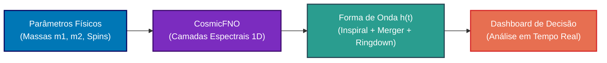

<div align="center">

# 🌌 CosmicFNO
### Emulação Ultrarrápida de Ondas Gravitacionais e Análise Espectral de Buracos Negros Utilizando Fourier Neural Operators

[](https://www.python.org/)
[](https://pytorch.org/)
[](https://github.com/)
[](https://www.black-holes.org/waveforms/)
[](https://www.facom.ufu.br/)

<br>

**Trabalho de Conclusão de Curso (TCC)**  
*Bacharelado em Sistemas de Informação*  
**Faculdade de Computação (FACOM) — Universidade Federal de Uberlândia (UFU)**  
**Autora:** Shayene Figueredo

</div>

---

## 🎯 Sobre o Projeto

O **CosmicFNO** é uma abordagem de ponta em *AI for Science* que utiliza **Fourier Neural Operators (FNO)** para prever e emular ondas gravitacionais emitidas pela fusão de buracos negros binários (*Binary Black Holes - BBH*).

Enquanto simulações de Relatividade Numérica clássicas em supercomputadores (HPC) exigem **dias ou semanas** para resolver as equações de campo de Einstein para um único evento, o **CosmicFNO** realiza essa predição no domínio espectral em **milissegundos**, alcançando aceleração de ordens de magnitude com erro relativo inferior a 1%.



---

## ⚡ Por que Fourier Neural Operators (FNO)?

1. **Invariância de Resolução:** Ao contrário de CNNs tradicionais, o FNO aprende mapeamentos contínuos entre espaços funcionais, permitindo avaliar a onda em qualquer taxa de amostragem sem retreinamento.
2. **Operação no Domínio de Frequência:** Inspirado na visão de frequências e vibrações, o operador espectral captura naturalmente as frequências de ressonância dos **Modos Quasinormais (QNM)** no amortecimento do buraco negro (*Ringdown*).
3. **Substituto Ultrarrápido (*Surrogate Model*):** Viabiliza a inferência de parâmetros em tempo real para observatórios como LIGO, Virgo e KAGRA.

---

## 📂 Estrutura do Repositório

```text
cosmic-fno/
├── dados/               # Dados processados e metadados das formas de onda
├── docs/                # Monografia em LaTeX/Markdown, referências e propostas
├── experimentos/        # Scripts de modelagem, treinamento e benchmarks
├── wiki/                # Documentação didática e base de conhecimento passo a passo
│   ├── 00_TRILHA_DE_APRENDIZAGEM.md
│   ├── 01_CONCEITOS_FISICOS_ONDAS_GRAVITACIONAIS.md
│   └── ...
├── .gitignore           # Filtro para ignorar datasets pesados e checkpoints
└── README.md            # Apresentação principal do projeto
```

---

## 📖 Trilha de Aprendizagem & Documentação (Wiki)

Toda a teoria física, cálculos matemáticos e explicações de código linha a linha estão documentados na nossa Wiki interna:

- 🌌 **[Módulo 01: Conceitos Físicos e Ondas Gravitacionais](wiki/01_CONCEITOS_FISICOS_ONDAS_GRAVITACIONAIS.md)**
- 📐 **[Módulo 02: Matemática de Fourier & Frequências](wiki/02_MATEMATICA_FOURIER_DO_ZERO.md)**
- 🛠️ **[Módulo 03: Engenharia de Dados & Catálogo SXS](wiki/03_ENGENHARIA_DADOS_SXS.md)**
- 🧠 **[Módulo 04: Redes Neurais & Arquitetura FNO](wiki/04_IA_FOURIER_NEURAL_OPERATOR.md)**
- 📊 **[Módulo 05: Métricas Científicas e Benchmarks](wiki/05_METRICAS_E_EXPERIMENTOS.md)**
- 🖥️ **[Módulo 06: Dashboard e Sistemas de Informação](wiki/06_SISTEMA_DASHBOARD_FIGMA.md)**

Consulte o mapa completo em **[Trilha de Aprendizagem](wiki/00_TRILHA_DE_APRENDIZAGEM.md)**.

---

## 🛠️ Tecnologias Utilizadas

- **Linguagem:** Python 3.10+
- **Deep Learning / AI for Science:** PyTorch, NeuralOperator
- **Processamento Espectral & Dados:** NumPy, SciPy, Pandas
- **Visualização Científica:** Matplotlib, Seaborn
- **Design & Interface:** Figma (Design System & Dashboard)
- **Base de Dados:** Catálogo SXS (*Simulating eXtreme Spacetimes*)

---

## 👩‍💻 Autora & Afiliação

* **Autora:** Shayene Figueredo
* **Curso:** Bacharelado em Sistemas de Informação (BSI)
* **Instituição:** Universidade Federal de Uberlândia (UFU) - Faculdade de Computação (FACOM)
* **Ano:** 2026 / 2028

---

<div align="center">
  <sub>"Se você quiser descobrir os segredos do Universo, pense em termos de energia, frequência e vibração." — Nikola Tesla</sub>
</div>
