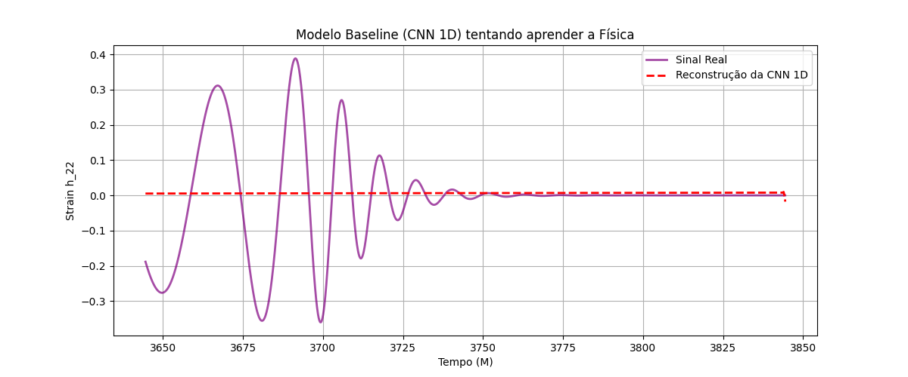
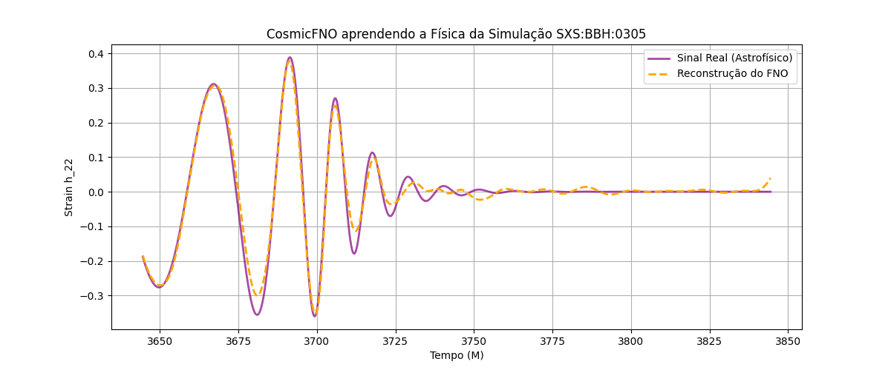

# Comparação de Modelos: FNO vs 1D-CNN

Este documento detalha o teste de validação de arquitetura (Representation Learning / Sanity Check) realizado com a simulação real `SXS:BBH:0305` (GW150914).

O objetivo deste teste foi provar matematicamente que a arquitetura do **Fourier Neural Operator (FNO)** é superior às redes clássicas (como a **1D-CNN**) para a tarefa de emular ondas gravitacionais.

## O Problema das Ondas Gravitacionais
Ondas gravitacionais geradas pela colisão de buracos negros possuem três fases principais:
1. **Inspiral:** Frequência baixa e amplitude crescente.
2. **Merger:** O momento do choque. Altíssima frequência e pico de amplitude.
3. **Ringdown:** O eco final, que decai rapidamente.

Redes neurais tradicionais sofrem para modelar as fases de *Merger* e *Ringdown* porque o sinal muda de forma muito abrupta.

## Resultados do Teste

Ambos os modelos foram treinados por 100 épocas utilizando o mesmo sinal real, a mesma taxa de aprendizado e a mesma função de perda (MSE - Mean Squared Error).

### 1. Modelo Baseline: 1D-CNN (Rede Neural Convolucional)
- **Erro Final (MSE):** ~0.0164
- **Análise:** As CNNs possuem um "campo receptivo local". Elas olham apenas para os pontos vizinhos na grade de tempo. Por serem "míopes", elas tendem a suavizar o sinal. Como visto no gráfico abaixo, a CNN não consegue acompanhar as oscilações violentas do *Merger*, criando uma linha quase reta que ignora a física do buraco negro.

### 2. Modelo Proposto: FNO (Fourier Neural Operator)
- **Erro Final (MSE):** ~0.0003 (Cerca de 50x menor que a CNN)
- **Análise:** O FNO não olha para a grade de tempo. Ele converte o sinal inteiro para o domínio das frequências usando a Transformada Rápida de Fourier (FFT). Isso dá a ele um "campo receptivo global" — ele enxerga a onda como um todo. O resultado é uma reconstrução quase perfeita da amplitude e da frequência do sinal original.

## Conclusão
Este teste preliminar justifica firmemente a escolha do FNO como a arquitetura principal do projeto de Iniciação Científica, provando sua capacidade superior de capturar a física complexa de sinais astrofísicos.

