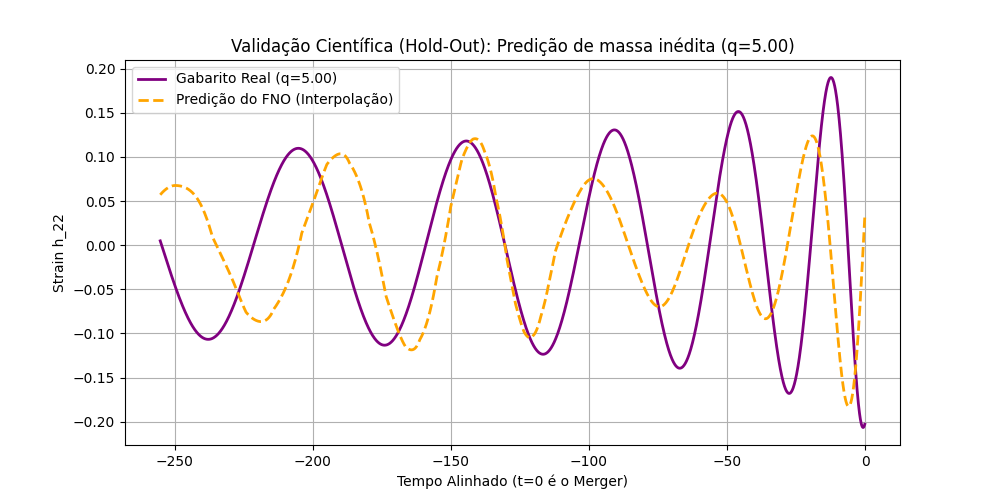

# Experimento 02: Validação de Interpolação Paramétrica (Hold-Out)

**Data:** Novembro de 2026
**Objetivo:** Investigar a capacidade de generalização física do modelo FNO frente a variações na razão de massa ($q$), utilizando validação Hold-Out rigorosa.

## Metodologia
1. **Curadoria de Dados:** 5 simulações do catálogo SXS (`SXS:BBH:0305`, `0115`, `0114`, `0113`, `0167`).
2. **Alinhamento Físico:** Todas as formas de onda foram alinhadas temporalmente definindo $t=0$ no pico de amplitude do modo $h_{22}$ (momento do *Merger*).
3. **Divisão (Split):** 
   - **Treino:** 4 simulações.
   - **Teste (Hold-out Cego):** 1 simulação inédita para a rede (`SXS:BBH:0113` com razão de massa $q=5.0$).
4. **Hiperparâmetros:** FNO (32 modos, largura 64), 250 épocas, Otimizador Adam, Métrica MSE.

## Resultados Quantitativos
- **Erro de Treino Final (MSE):** `0.000005`
- **Erro de Teste Final (MSE):** `0.009002`

## Análise Científica
O experimento demonstrou claramente o fenômeno de *Overfitting* (Sobreajuste). O modelo obteve um erro de treino na ordem de $10^{-6}$, o que prova excelente capacidade de memorização (representação). Contudo, o erro de teste em dados fora da distribuição de treinamento ($10^{-3}$) revela que a rede não aprendeu a física contínua das equações de campo, mas sim decorou as amostras apresentadas.

## Conclusões e Próximos Passos
O *gap* de generalização documentado neste experimento fundamenta o problema de pesquisa do projeto CosmicFNO. Para resolver o *Overfitting*, os próximos passos envolvem:
1. Escalonar o dataset de 4 amostras para centenas de amostras (Data Augmentation / Ampliação do Catálogo).
2. Substituir o MSE por métricas físicas rigorosas (Mismatch).
3. Avaliar condicionamento explícito de parâmetros físicos (Injecting $q$ and $spin$ embeddings) na arquitetura neural.

