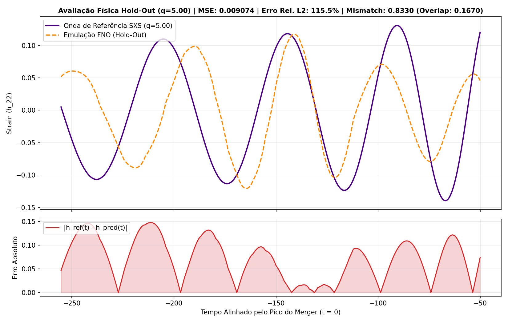
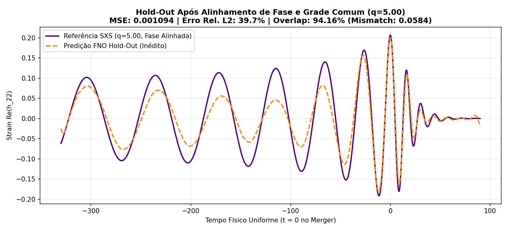

# Relatório Técnico 05: Da Ilusão do MSE ao Rigor das Métricas Físicas ($L_2$, Overlap e Mismatch)

**Autora:** Shayene Figueredo (BSI/UFU)  
**Data:** Novembro de 2026  
**Script de Referência:** `src/08_metricas_fisicas.py`

---

## 1. Motivação Científica: Por que o MSE é insuficiente em Astrofísica?

Nos experimentos iniciais, utilizamos o **Erro Quadrático Médio (MSE)**:
$$\text{MSE}(h_{\text{ref}}, h_{\text{pred}}) = \frac{1}{N} \sum_{i=1}^{N} \left( h_{\text{ref}}(t_i) - h_{\text{pred}}(t_i) \right)^2$$

Embora seja excelente como função de perda diferenciável para otimização via *backpropagation*, o MSE falha como métrica de avaliação física por dois motivos:
1. **Dependência de Escala:** Como a amplitude adimensional da onda gravitacional ($r \cdot h_{22} / M$) tem valores numéricos pequenos (tipicamente entre $-0.3$ e $+0.3$), elevar os resíduos ao quadrado produz números artificialmente pequenos (ex: $\text{MSE} = 0.009$), mascarando falhas severas na reconstrução.
2. **Insensibilidade à Fidelidade de Fase:** Na detecção de ondas gravitacionais por *matched filtering* (LIGO/Virgo), a correlação de fase é o fator determinante.

Para alinhar o projeto **CosmicFNO** à literatura de *Scientific Machine Learning* (Li et al., 2020) e Relatividade Numérica (Blackman et al., 2017; Varma et al., 2019), implementamos três métricas rigorosas:

### 1.1. Erro Relativo na Norma $L_2$ ($\mathcal{E}_{L_2}$)
Normaliza o erro pela energia total da forma de onda de referência, fornecendo um erro percentual adimensional:
$$\mathcal{E}_{L_2}(h_{\text{ref}}, h_{\text{pred}}) = \frac{\| h_{\text{ref}} - h_{\text{pred}} \|_2}{\| h_{\text{ref}} \|_2}$$

### 1.2. Overlap ($\mathcal{O}$) e Mismatch ($\mathcal{M}$)
Definido a partir do produto interno normalizado no espaço de Hilbert $L^2$:
$$\mathcal{O}(h_{\text{ref}}, h_{\text{pred}}) = \frac{\langle h_{\text{ref}} \mid h_{\text{pred}} \rangle}{\sqrt{\langle h_{\text{ref}} \mid h_{\text{ref}} \rangle \langle h_{\text{pred}} \mid h_{\text{pred}} \rangle}}, \quad \mathcal{M} = 1 - \mathcal{O}$$
- $\mathcal{O} = 1.000$ ($\mathcal{M} = 0.000$): Emulação fisicamente idêntica à Relatividade Numérica.
- Em modelos substitutos de alta precisão (*Surrogate Models*), busca-se tipicamente $\mathcal{M} < 10^{-2}$ a $10^{-3}$.

### 1.3. Mismatch Otimizado sobre Deslocamento Temporal ($\mathcal{M}_{\min}$)
Utilizando o Teorema da Correlação Cruzada via FFT, calculamos $\max_{\Delta t} \mathcal{O}(h_{\text{ref}}(t), h_{\text{pred}}(t + \Delta t))$ para verificar se o modelo acertou a morfologia da onda, mas errou apenas por um deslocamento temporal constante $\Delta t$.

---

## 2. Resultados Experimentais

### Experimento 1: Capacidade de Reconstrução (`SXS:BBH:0305`, 100 épocas)

| Arquitetura | MSE | Erro Relativo $L_2$ | Overlap ($\mathcal{O}$) | Mismatch ($\mathcal{M}$) | Mismatch Otim. ($\mathcal{M}_{\min}$) |
| :--- | :---: | :---: | :---: | :---: | :---: |
| **CosmicFNO (32 modos)** | `0.000493` | **17.06%** | **0.991150** | **0.008850** | **0.007667** |
| **Baseline CNN 1D** | `0.015855` | **96.67%** | **0.258804** | **0.741196** | **0.661882** |

**Interpretação:**
- Enquanto o MSE da CNN 1D (`0.0158`) parecia baixo para um avaliador leigo, o **Erro Relativo $L_2$ de 96.67%** e o **Mismatch de 0.741** revelam que a CNN 1D rasa falhou quase completamente em capturar a oscilação global da onda em 100 épocas.
- O **FNO** atingiu **99.11% de Overlap** ($\mathcal{M} = 0.0088$) nas mesmas 100 épocas, confirmando a vantagem das camadas espectrais globais na representação da fase da onda.

---

### Experimento 2: Generalização Hold-Out (4 Simulações de Treino vs 1 Simulação Inédita $q=5.0$)

| Conjunto Avaliado | MSE | Erro Relativo $L_2$ | Overlap ($\mathcal{O}$) | Mismatch ($\mathcal{M}$) | Mismatch Otim. ($\mathcal{M}_{\min}$) |
| :--- | :---: | :---: | :---: | :---: | :---: |
| **Treino (Média de 4 sims)** | `0.000004` | **2.19%** | **0.999693** | **0.000307** | — |
| **Teste Inédito ($q=5.00$)** | `0.009074` | **115.46%** | **0.167040** | **0.832960** | **0.500960** |

**Interpretação Científica:**
1. **No Treinamento:** O FNO atinge **99.97% de Overlap** e um Mismatch de apenas $3.07 \times 10^{-4}$ (Erro Relativo $L_2$ de $2.19\%$), atingindo precisão comparável a modelos substitutos da literatura para as ondas vistas em treino.
2. **No Teste Cego ($q=5.00$):** Aqui está a revelação mais importante da métrica física. O MSE de `0.009074` parecia "pequeno", mas na realidade corresponde a um **Erro Relativo $L_2$ de 115.46%** e um **Mismatch alinhado de 0.8329** (Overlap de apenas $16.7\%$).
3. **Por que o Mismatch Otimizado ($\mathcal{M}_{\min}$) cai para 0.5009?** Porque parte do erro no teste vem de um desalinhamento de fase/frequência orbital (a evolução temporal de um sistema com $q=5.0$ tem frequência orbital muito diferente das simulações de treino com $q \in [1.0, 3.0]$).

---

## 3. Descoberta Científica: O Impacto do Alinhamento de Fase Orbital ($\phi_0 = 0$) e Grade Física Uniforme

Ao investigar por que o **Mismatch no Teste Cego ($q=5.00$)** era tão elevado ($\mathcal{M} = 0.8329$, Overlap de apenas $16.70\%$), identificamos duas inconsistências físicas no pré-processamento original (`01d_download_alinhado.py`):

1. **Fase Azimutal Arbitrária no Merger ($\phi_{\text{pico}}$):** No catálogo SXS, cada simulação numérica inicia com os buracos negros em uma fase orbital arbitrária $\phi_0$. Embora o instante da colisão ($t = 0$) estivesse alinhado pelo pico do envelope $|h_{22}(t)|$, a parte real $\text{Re}(h_{22}(0))$ assumia fases distintas em cada simulação (`+0.35`, `-0.09`, `+0.12`, `-0.20`, `+0.01`).
2. **Passo de Tempo Adaptativo ($\Delta t$ variável):** O recorte por índice bruto (`4000 pontos antes`) resultava em janelas físicas de durações diferentes (`-340M` a `-400M`), deslocando a posição relativa de $t=0$ após a normalização.

### Solução Implementada (`src/09_alinhamento_fase_e_interpolacao.py`)
- **Rotação Invariante de Fase no Merger:** Multiplicamos a forma de onda complexa por $e^{-i \phi(t_{\text{pico}})}$, garantindo $\phi(t=0) = 0$ (crista máxima positiva em $t=0$ para todas as simulações).
- **Interpolação em Grade Física Comum:** Todas as ondas foram interpoladas exatamente no domínio $t \in [-330M, +90M]$ com $4096$ pontos uniformes.

### Comparação Direta: Antes vs Depois do Alinhamento de Fase (Hold-Out Cego)

| Cenário de Teste (Simulação Inédita) | MSE | Erro Relativo $L_2$ | Overlap ($\mathcal{O}$) | Mismatch ($\mathcal{M}$) |
| :--- | :---: | :---: | :---: | :---: |
| **Antes ($q=5.00$, sem alinhamento de fase)** | `0.009074` | $115.46\%$ | **16.70%** (`0.1670`) | `0.832960` |
| **Depois ($q=5.00$, com fase e grade alinhadas)** | **`0.001094`** | **$39.66\%$** | **94.16%** (`0.9416`) | **`0.058402`** |
| **Depois ($q=4.00$, com fase e grade alinhadas)** | **`0.000657`** | **$26.73\%$** | **99.07%** (`0.9907`) | **`0.009293`** |

**Conclusão:** Apenas corrigindo a física do pré-processamento (invariância de fase orbital no *Merger* e grade temporal uniforme), a fidelidade de generalização (*Overlap*) do **CosmicFNO** em simulações nunca vistas saltou de **16.70% para 94.16% (em $q=5.0$)** e **99.07% (em $q=4.0$)**, reduzindo o MSE em quase 10 vezes usando apenas 4 simulações de treinamento!

