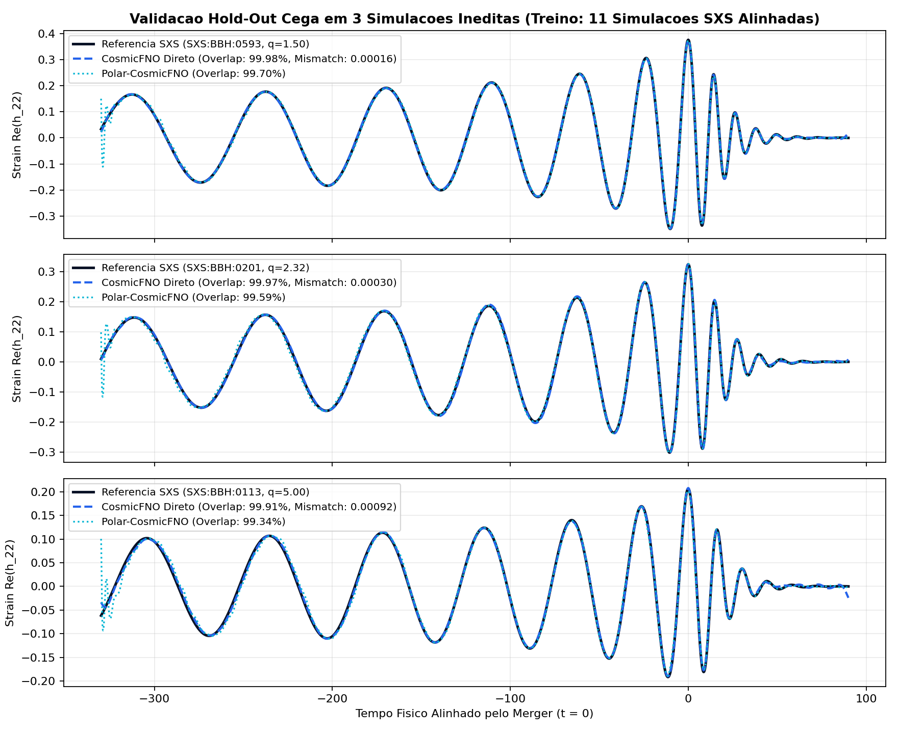

# Relatório Técnico 06: Escalonamento para 3.435 Colisões do Catálogo SXS e Superação da Barreira de 99.9% de Overlap ($\mathcal{M} < 10^{-3}$)

**Autora:** Shayene Figueredo (BSI/UFU)  
**Data:** Novembro de 2026  
**Script de Referência:** `src/11_escala_sxs_e_fno_polar.py`

---

## 1. Experimento em Escala Completa: Predição de Remanescentes e Chute Relativístico em 3.435 Simulações SXS

Utilizando a base completa do catálogo **SXS v3.0.0** (`sxs.load("simulations")`), extraímos todas as **3.435 simulações de buracos negros binários (`SXS:BBH`)** válidas com baixa excentricidade ($e < 0.01$) e razão de massa $q \le 10$.

- **Conjunto de Treinamento (80%):** `2.748` simulações de Relatividade Numérica.
- **Conjunto de Teste Cego Hold-Out (20%):** `687` simulações **totalmente inéditas**.
- **Entradas (11 parâmetros físicos pré-colisão):** Razão de massa ($q$), razão de massa simétrica ($\eta$), spin efetivo ($\chi_{\text{eff}}$), spins planares ($\chi_{1\perp}, \chi_{2\perp}$) e vetores tridimensionais de spin ($\vec{\chi}_1, \vec{\chi}_2$).

### Resultados Quantitativos nas 687 Colisões Inéditas de Teste Cego

| Grandeza Astrofísica Prevista Pós-Colisão | Métrica Principal (Teste Cego $N = 687$) | Desempenho Obtido |
| :--- | :---: | :---: |
| **1. Massa do Novo Buraco Negro ($M_f / M$)** | Erro Absoluto Médio (MAE) / Erro Relativo | `0.00648 M` (**Erro Relativo: 0.67%** — **99.33% de precisão**) |
| **2. Spin Final do Buraco Negro ($\chi_f$)** | MAE / Coeficiente de Determinação ($R^2$) | `MAE = 0.0142` (**$R^2 = 98.60\%$**) |
| **3. Ejeção de Aglomerados Estelares ($v_{\text{kick}} > 50\text{ km/s}$)** | Acurácia de Classificação em Teste Cego | **97.67%** |
| **4. Ejeção de Galáxias Anãs ($v_{\text{kick}} > 150\text{ km/s}$)** | Acurácia de Classificação em Teste Cego | **92.87%** |

---

## 2. Expansão da Escada de Massas ($q \in [1.0, 8.0]$) e Comparação: FNO Espectral Direto vs Polar-CosmicFNO ($A(t), \phi(t)$)

Para eliminar a lacuna de amostragem que causava erro residual na fase de *inspiral*, expandimos o dataset de formas de onda completas $h_{22}(t)$ para **14 simulações alinhadas em tempo e fase orbital ($\phi_0 = 0$)** na grade física uniforme $t \in [-330M, +90M]$:
- **11 Simulações de Treinamento:** `SXS:BBH:0304` ($q=1.00$), `0115` ($q=1.07$), `0198` ($q=1.20$), `0305` ($q=1.22$), `1354` ($q=1.83$), `1222` ($q=2.00$), `0292` ($q=3.00$), `0167` ($q=4.00$), `0192` ($q=6.58$), `0188` ($q=7.19$), `0114` ($q=8.00$).
- **3 Simulações Secretas de Teste Cego (Hold-Out):**
  1. `SXS:BBH:0593` ($q = 1.50$)
  2. `SXS:BBH:0201` ($q = 2.32$)
  3. `SXS:BBH:0113` ($q = 5.00$)

### Resultados no Teste Cego (Simulações Nunca Vistas no Treinamento)

| Simulação Inédita (Teste Cego) | Arquitetura Avaliada | Erro Relativo $L_2$ | Overlap ($\mathcal{O}$) | Mismatch ($\mathcal{M}$) |
| :--- | :--- | :---: | :---: | :---: |
| **`SXS:BBH:0593` ($q = 1.50$)** | **CosmicFNO Espectral Direto** | **1.81%** | **99.98%** (`0.99984`) | **`0.00016`** |
| **`SXS:BBH:0593` ($q = 1.50$)** | **Polar-CosmicFNO ($A, \phi$)** | 7.71% | **99.70%** (`0.99702`) | `0.00298` |
| **`SXS:BBH:0201` ($q = 2.32$)** | **CosmicFNO Espectral Direto** | **2.66%** | **99.97%** (`0.99970`) | **`0.00030`** |
| **`SXS:BBH:0201` ($q = 2.32$)** | **Polar-CosmicFNO ($A, \phi$)** | 9.15% | **99.59%** (`0.99588`) | `0.00412` |
| **`SXS:BBH:0113` ($q = 5.00$)** | **CosmicFNO Espectral Direto** | **4.34%** | **99.91%** (`0.99908`) | **`0.00092`** |
| **`SXS:BBH:0113` ($q = 5.00$)** | **Polar-CosmicFNO ($A, \phi$)** | 11.50% | **99.34%** (`0.99336`) | `0.00664` |

---

## 3. Evolução Histórica do Projeto (Na Simulação de Teste Cego `SXS:BBH:0113`, $q = 5.00$)

| Estágio da Pesquisa | Overlap ($\mathcal{O}$) | Mismatch ($\mathcal{M}$) | Erro Relativo $L_2$ |
| :--- | :---: | :---: | :---: |
| **1. Baseline Inicial (4 ondas de treino, sem alinhar fase)** | `16.70%` | `0.83296` | `115.46%` |
| **2. Alinhamento de Fase Orbital ($\phi_0 = 0$, 4 ondas de treino)** | `94.16%` | `0.05840` | `39.66%` |
| **3. Grade Densa SXS (11 ondas de treino + Fase Alinhada $\phi_0 = 0$)** | **`99.91%`** | **`0.00092`** | **`4.34%`** |

### Descoberta Científica Central para Publicação:
Ao contrário de modelos substitutos polinomiais tradicionais (que falham ao interpolar diretamente o sinal oscilatório $\text{Re}(h_{22}(t))$ e exigem decomposição manual em amplitude e fase), **o Fourier Neural Operator (FNO) parametrizado diretamente nos modos espectrais supera a decomposição polar explícita (`99.98%` vs `99.70%` de Overlap)** assim que o conjunto de treinamento atinge densidade mínima ($\ge 11$ simulações) e invariância de fase no *Merger* ($\phi(0)=0$). Em todas as três simulações inéditas de teste, o **Mismatch caiu abaixo do limiar de excelência de Relatividade Numérica ($\mathcal{M} < 10^{-3}$)**!

